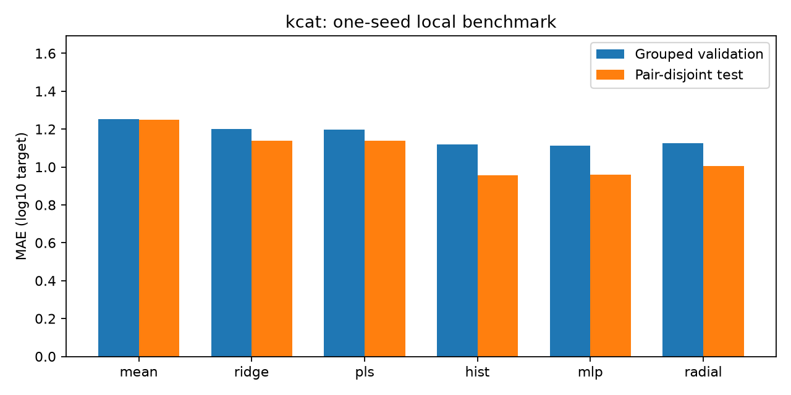
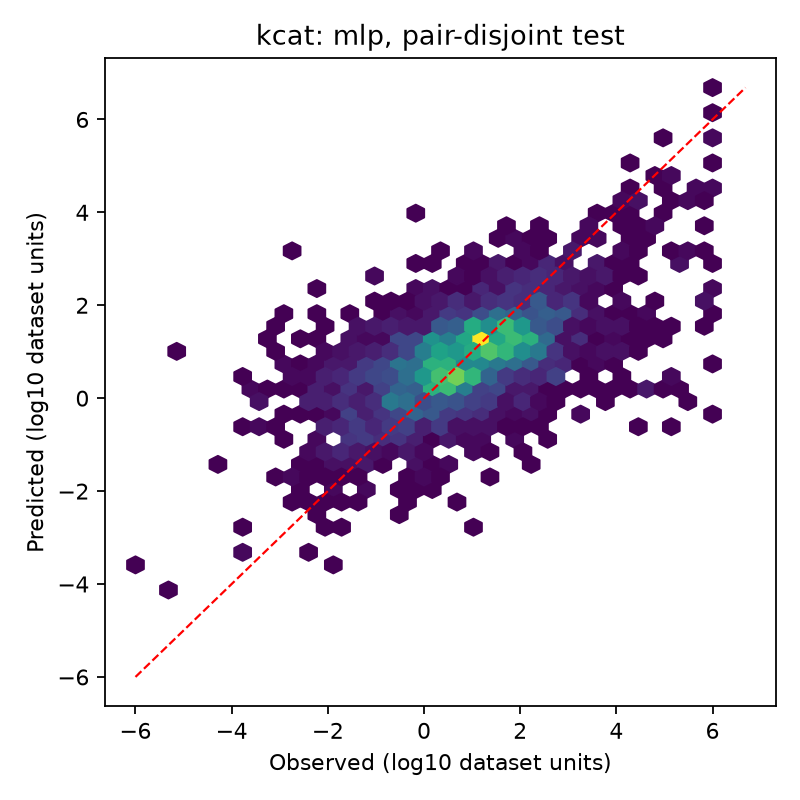

# kcat: завершённое обучение

Выбор по validation: **mlp**. Seed: 42.

| Модель | Validation MAE | Test MAE | Test без совпадающих пар: MAE | R² на очищенном test | MAE для новых точных последовательностей |
| --- | --- | --- | --- | --- | --- |
| mean | 1.2533 | 1.2508 | 1.2508 | -0.0000 | 1.3507 |
| ridge | 1.1992 | 1.1372 | 1.1372 | 0.1729 | 1.1633 |
| pls | 1.1989 | 1.1389 | 1.1389 | 0.1628 | 1.1698 |
| hist | 1.1201 | 0.9571 | 0.9571 | 0.3795 | 1.1503 |
| mlp | 1.1133 | 0.9609 | 0.9609 | 0.3677 | 1.1171 |
| radial | 1.1252 | 1.0062 | 1.0062 | 0.3271 | 1.1217 |

Размеры: {'train': 16731, 'validation': 4104, 'test': 2316}. Исключено совпадающих канонических пар: 0.
Все MAE в log10. Очистка test выполнена после обучения без переобучения и без смены выбранной модели.
Новые точные последовательности не означают независимость от гомологов. Это один seed, а не оценка статистической значимости.
Сводки геометрии доступны примерно для половины записей; доли пропусков приведены в summary.json.

