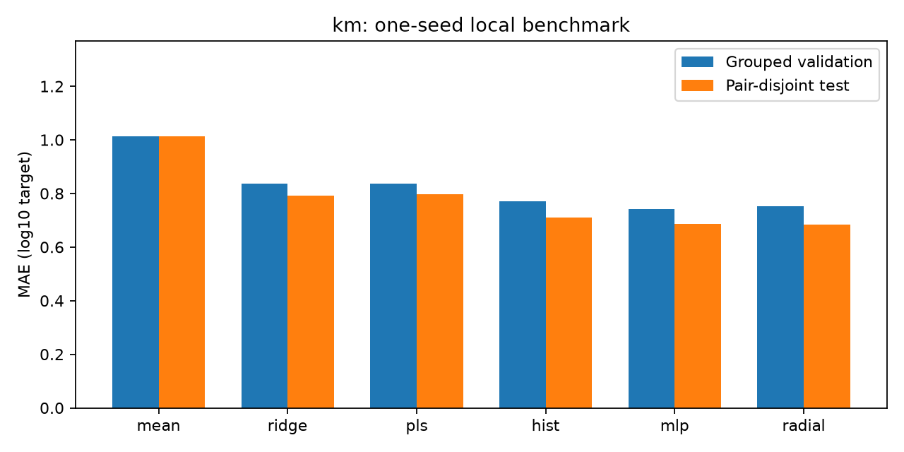
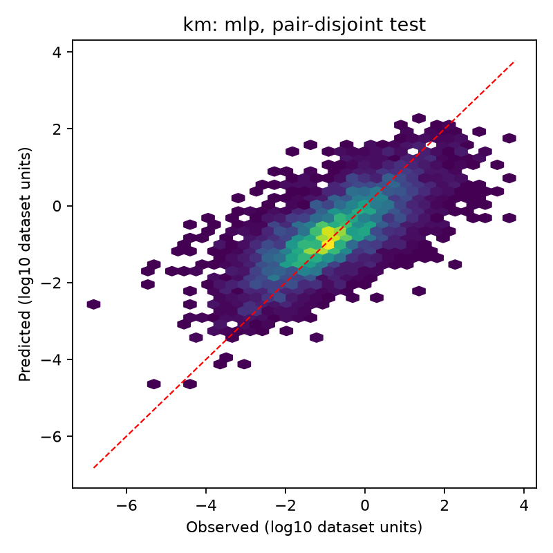

# km: завершённое обучение

Выбор по validation: **mlp**. Seed: 42.

| Модель | Validation MAE | Test MAE | Test без совпадающих пар: MAE | R² на очищенном test | MAE для новых точных последовательностей |
| --- | --- | --- | --- | --- | --- |
| mean | 1.0138 | 1.0136 | 1.0142 | -0.0017 | 1.0149 |
| ridge | 0.8374 | 0.7929 | 0.7929 | 0.3570 | 0.8247 |
| pls | 0.8365 | 0.7968 | 0.7967 | 0.3514 | 0.8305 |
| hist | 0.7710 | 0.7087 | 0.7089 | 0.4766 | 0.7718 |
| mlp | 0.7414 | 0.6850 | 0.6853 | 0.5031 | 0.7154 |
| radial | 0.7521 | 0.6837 | 0.6839 | 0.5035 | 0.6954 |

Размеры: {'train': 29557, 'validation': 7499, 'test': 4118}. Исключено совпадающих канонических пар: 5.
Все MAE в log10. Очистка test выполнена после обучения без переобучения и без смены выбранной модели.
Новые точные последовательности не означают независимость от гомологов. Это один seed, а не оценка статистической значимости.
Сводки геометрии доступны примерно для половины записей; доли пропусков приведены в summary.json.

