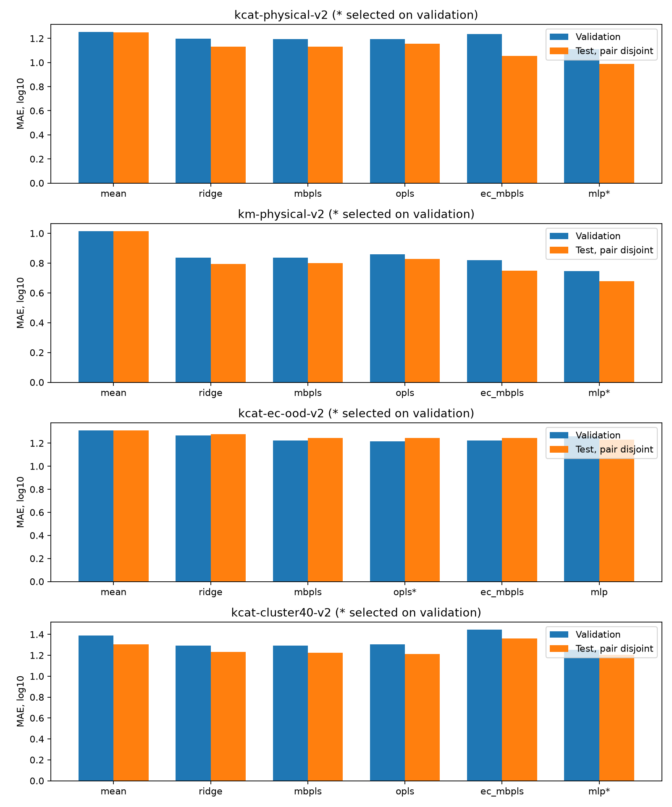

# Физические признаки и хемометрика: эксперименты v2

Дата: 1 ноября 2026. Один seed: 42. Модель выбирается по validation.

| Run | Модель | Train / val / test | MAE test без совпадающих пар | R² | Пересечение test-групп |
| --- | --- | --- | --- | --- | --- |
| [kcat-physical-v2](kcat-physical-v2/README.md) | mlp | 16731 / 4104 / 2316 | 0.9883 | 0.3481 | 1965 |
| [km-physical-v2](km-physical-v2/README.md) | mlp | 29557 / 7499 / 4118 | 0.6797 | 0.5119 | 3627 |
| [kcat-ec-ood-v2](kcat-ec-ood-v2/README.md) | opls | 17924 / 1883 / 3344 | 1.2451 | 0.0731 | 0 |
| [kcat-cluster40-v2](kcat-cluster40-v2/README.md) | mlp | 14571 / 4182 / 4398 | 1.2057 | 0.1227 | 0 |

У provided-test сохраняется исходный test, а validation разнесена по exact sequence. Поэтому пересечение test-групп здесь ожидаемо и отражает ограничение исходного split.

EC-OOD и cluster40 используют новые grouped-three-way части. Нулевое пересечение EC/cluster ID не доказывает аудит происхождения кластеров и отсутствие иных видов dataset leakage. Числа разных split нельзя напрямую ранжировать как улучшение модели.

По сравнению с v1 kcat MLP ухудшилась 0.9609 → 0.9883; Km MLP немного улучшилась 0.6853 → 0.6797. Один seed и низкое покрытие физических признаков не подтверждают устойчивую пользу. Старый test уже просматривался; это исследовательские сравнения, нужен новый внешний holdout.

3 841 pocket-запись; 34 ошибки extraction. QM: 4 успеха из 32 выбранных SMILES, 28 отказов преимущественно из-за разъединённых реагентов. Покрытие по train/validation/test записано в summary.json. Электростатические и MD-таблицы пилота не включены в массовое обучение: неизвестная ионная сила assay не заменяется предполагаемой.

[Реальный пилот физических backend](physical-pilot/manifest.json) и его артефакты не являются доказательством свободноэнергетического барьера. Production MD — 0.2 ps, недостаточная термализация. ESM-2 рассчитан на двух последовательностях, не на всём датасете. [Статусы и следующий цикл](../../IMPLEMENTATION_STATUS.md).

[Полная таблица](comparison.csv), [проверка reload](reload-verification.json). В подпапках — все метрики и SHA-256 локальных артефактов.
