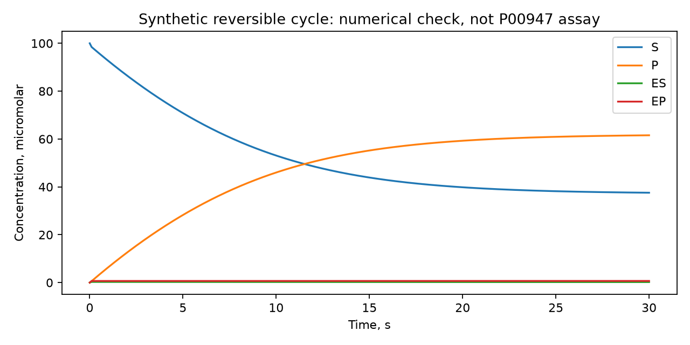

# Физические backend: фактическая проверка

[Сквозной manifest](manifest.json) содержит успешные P2Rank, GFN2-xTB,
PDB2PQR/APBS и OpenMM для локального P00947. Это apo AlphaFold-мономер;
не подготовленный ES и не экспериментально валидированный биологический димер.
Предполагаемая ионная сила 0.15 M отмечена явно.

- [Карман](pocket.json): score, состав, центр, исходные хеши.
- [QM](quantum.json): электронные параметры конкретной геометрии субстрата;
  нет расчёта активационного барьера.
- [APBS](electrostatics.json): LPBE, сетка 65³, потенциал/поле и checksum solver.
  Проверка сходимости сетки ещё не выполнена.
- [Отдельное screened-Coulomb приближение](screened-coulomb.json): другой
  электростатический метод; его значения не приравниваются к APBS.
- [MD](dynamics.json): production 0.2 ps, пять кадров.
  [Температура и энергии](md-state.csv) демонстрируют недостаточную термализацию.
- [Проекция поля по пяти кадрам](trace.json), [числа](trace.csv): явная CA-пара,
  fixed-charge screened Coulomb; не каталитическая связь и не APBS по кадрам.
- [ESM-2 pilot](esm2-pilot.json): две последовательности, 320 dimensions,
  immutable revision; не полное ESM-обучение.
- [Установка APBS](apbs-installation.json): официальный URL, SHA-256 архива и executable.

Полные PDB/PQR, input APBS, DX-сетка, DCD, System XML и checkpoint остаются
локально в `enzyme-kinetics/outputs/backend_checks/p00947-integrated-v4-apbs/`.
Прошлые неудачные runs сохранены с ошибочными manifest для диагностики.

## Проверка кинетической временной симуляции

[Численная проверка](synthetic-reaction.json) использует явно заданные
синтетические элементарные константы. Сохранение фермента и субстрата
проверено численно; эти значения не являются константами P00947.

Научные критерии приёмки: [матрица реализации](../../../IMPLEMENTATION_STATUS.md).
