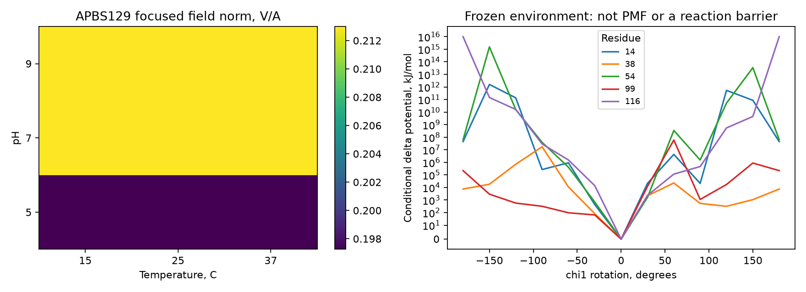
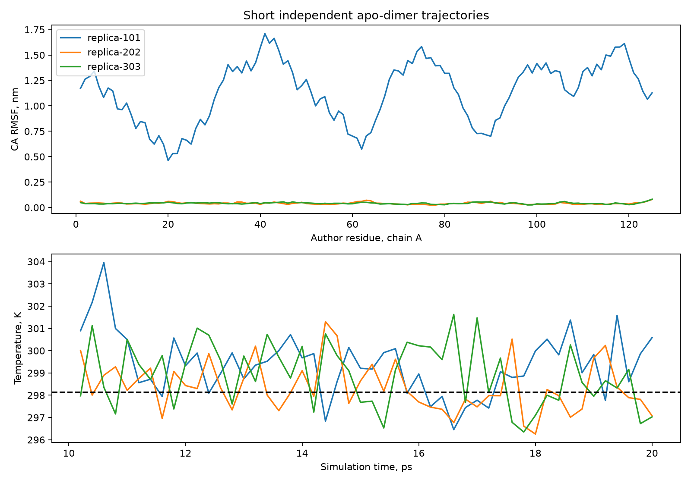
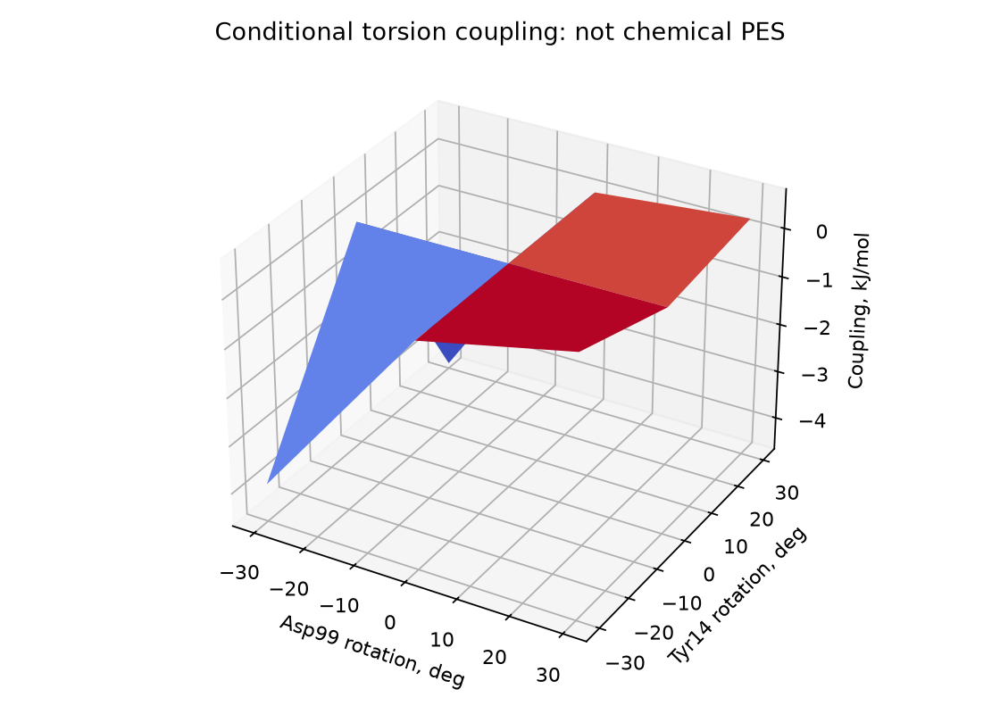

# Активный центр, условия среды и взаимное влияние: серия 0.3

1 ноября 2026. [Протокол и регистрация](../PROTOCOL.md),
[дневник](DIARY.md), [сводный журнал UTC](all-events.jsonl),
[сводка результатов](summary.json), [таблица остатков](site-residues.csv).

## Продолжение: проверка P00947

Новые результаты и команды — [журнал](experiment-log.md). Прежние результаты
ниже сохранены как исторические и не заменяются новыми предположениями.

| Этап | Статус |
| --- | --- |
| 1. Assay и карточка | Частично: [карточка](reaction-card-P00947.md); таблица статьи сверена, локальный изомер совпадает с PubChem; точная партия assay и β-H не подтверждены |
| 2. Replica 101 | Причина скачка установлена: периодическое изображение, см. ниже и [журнал](experiment-log.md); вся серия и статистики ещё не пересчитаны |
| 3. WT–ES | Две позы минимизированы; дополнительно сохранены 48 O вод 8CHO для модели 101; β-H и структуры остаются модельными — [отчёт](tools-and-complex.md) |
| 4. Гипотезы | Две проверяемые гипотезы предложены, не подтверждены: [механизмы](mechanisms-P00947.md) |
| 5. QM/MM | Заблокирован: не выполнены предварительные критерии assay и WT–ES; новых запусков нет |
| 6. Статус и журнал | Обновлены; исправленный полный расчёт ансамбля остаётся незавершённым |

Дополнительный [аудит минимизации модели 101](minimization-audit-101.md):
четыре блока до 300 итераций на CPU не подтвердили сходимость; в последнем энергия
всей системы изменилась ещё на −3 176 кДж/моль. Геометрия активного центра
сохранилась, однако это не свидетельствует о равновесной или корректной ES-позе.
Аудит v2 пока только предзарегистрирован: пользователь разрешил восстановить
simulation box из system.xml; прежний State XML отсутствует, новых расчётов нет.
Для MD-pipeline выполнен ограниченный межмолекулярный PBC-аудит: пар <1,5 Å
нет в заданных категориях. Короткий NVT при 298,15 K не прошёл энергетический
критерий, причём из-за ошибки кода не остановился на 6 ps; этап 2 заблокирован,
готовность к эквилибрации не установлена. Подробности —
`enzyme-kinetics/outputs/active-site-v3/md-pipeline-101/REPORT-02-quench.md`.
Первичная геометрия GLU43 сопоставлена с 8CHO; сравнительный свип не выполнен.

Исторический анализ replica 101 в `research/ensemble.py` фиксировал кадр 0
и тот же набор CA, но выравнивал необработанный периодический димер. Диагностика обнаружила 10
кадров в другом образе; после переноса цепи B на вектор периодической ячейки
средние RMSD половин — 0.05359 и 0.07075 нм вместо 0.05359 и 1.23276 нм.
Следовательно, большой скачок — артефакт обработки PBC, а не установленное
движение белка. Это не доказывает стабильность димера. Прежние RMSF, DCCM и
статистические выводы, включающие replica 101, требуют повторного анализа;
исторические значения ниже не следует считать исправленными.
Новый общий алгоритм и отдельный воспроизводимый пересчёт 101/202/303:
[C1: PBC и структурные метрики](c1-pbc/README.md).

## Аминокислоты и пространственная конформация

Для tKSI P00947 аннотированы Tyr14/Asp99 — oxyanion hole; Asp38 — общая
кислота/основание; Phe54/Phe116 — позиционирование основания и гидрофобное
окружение; Pro39 — организация основной цепи рядом с Asp38.

В контактах с аналогами найдены, в частности, Leu18, Tyr55, Ser58, Leu61,
Leu63, Phe82, Val84, Phe86, Val95, Pro97, Met112, Ala114, Phe116 и Ile121.
Состав зависит от аналога/мутаций и cutoff 4.5 Å. Это кандидаты связывания,
а не автоматически доказанные каталитические остатки WT с нашим субстратом.
Тяжёлые атомы, номера цепей, chi1/chi2, phi/psi/omega и парные расстояния сохранены в
[H1](H1-static-sites.json). Координаты в Å, углы в градусах. У Pro39 omega≈0.375° подтверждает cis-геометрию связи Asp38–Pro39 в 8CHO.

WT 8CHO нормализован в биологический димер A/B; 1QJG содержит D38N, 1OHS —
Y14F/D38N. EQU и насыщенный 5SD не объявляются реакционным Delta5-субстратом.
B-факторы кристалла и pLDDT AlphaFold не использовались как взаимозаменяемые
измерения гибкости. [Исходные файлы и SHA-256](inputs.json).

## pH, pI, температура и соль

Выполнен факторный план из 27 комбинаций pH 5/7/9, T 15/25/37 °C,
I 0/0.15/0.30 M. Первичный расчёт APBS65 имел недостаточную сеточную
сходимость: изменение поля 97³→129³ — 13.8%, 129³→193³ — 17.3%.
Фокусировка fine-box 20 Å вокруг активного центра дала изменение
97³→129³ **0.75%** при центральных условиях. Уточнённый факторный план из 27 расчётов завершён. Проверки крайних
условий дали изменения 0.67% и 0.74%; все три проверенные точки прошли
критерий 10%. [Таблица](conditions-factorial-focused.csv),
[проверки](H2e-refined-factorial.json). Первичные результаты не удалены.

PROPKA для WT-димера предсказывает pI folded≈5.83, pKa(Asp38)≈6.31,
pKa(Asp99)≈9.03; это **модельные**, не измеренные значения.
Особенно большие оценки pKa Tyr14 требуют независимой проверки.
Последовательностный pI, Q(pH) и pH−pI добавлены в новые ML-признаки.
Глобальный pI не заменяет локальное протонирование активного центра.

Учтены температура в MD/APBS и отдельная чувствительность к epsilon воды(T).
Температурные сдвиги pKa без энтальпий ионизации, реальные параметры буфера,
популяции связанных микросостояний и constant-pH sampling пока не определены.
Все предположения отмечены; полного учёта среды этим не заявляется.

## Гибкость и сопряжённость

Три независимых seed WT-димера, 46 690 атомов с водой/ионами, 10 ps burn-in
и 10 ps production на каждую реплику. Температуры production в среднем
298.4–299.4 K. Рассчитаны CA RMSF, DCCM, боковые chi1/chi2, круговые моменты
и наблюдавшиеся переходы ротамеров. Подробные CSV — в replica-101/202/303.

Несмотря на 50 сохранённых кадров на реплику, оценка числа эффективных
RMSD-отсчётов составляет лишь около **4.7–6.7**. Температурная стабилизация
не означает сходимости конформационных распределений.

Проверки по независимым репликам: catalytic-vs-reference p=1.0;
positioning-vs-reference p=0.75; BH q=1.0 для обеих. Отличий этот пилот не
подтвердил. При n=3 минимальное двустороннее exact p=0.25: подтверждающий
дизайн требует большего числа независимых реплик и оценки мощности.
Reference здесь — остальные остатки вне двух тестируемых групп, включая
часть кандидатов связывания; это не отдельная доказанная механическая область.

Независимый frozen-environment торсионный скан выявил неаддитивность энергии
при совместных поворотах Tyr14/Asp99: максимум |ΔΔE|≈**4.57 кДж/моль**
в выбранной сетке ±30°. Это условное взаимодействие в силовом поле;
оно не является свободной энергией активации или доказательством причинного
влияния на kcat. Столкновения при больших поворотах сохранены в CSV.

## Механизм и седловые точки

Явная схема: E+S ⇌ ES → TS1 → EI → TS2 → EP ⇌ E+P.
Asp38 забирает C4β-H и затем переносит протон к C6; Tyr14/Asp99 стабилизируют
заряд промежуточного состояния. В коде заданы реакционные координаты,
численный Hessian и проверка индекса стационарной точки.

Пробная поза Delta5-субстрата, построенная из 1OHS/5SD с проверкой стереохимии
и совмещением на WT, **отклонена**: C4–O(Asp38)≈6.98 Å > лимита 4 Å.
У исходного аналога O17 расположен рядом с Asp99, а O3 — далеко.
Такую позу нельзя непосредственно использовать для химического барьера.
[Полный статус](H5-mechanism-status.json).

Дополнительно проверена кандидатная поза из продукта ASD в 3NHX
(отличия от 8CHO: I83T/D99N). Она прошла геометрический фильтр, CA RMSD
совмещения 0.299 Å. На 78-атомном capped-кластере выполнено 109 GFN2-xTB
оценок, рассчитана сетка 9×9 положения выбранного C4-H при замороженных
остальных атомах. [Поверхность](proton-surface/surface.png),
[энергии](proton-surface/surface.csv),
[геометрия и ограничения](proton-surface/H5-projected-proton-surface.json).

Найдена одна стационарная точка в двумерном подпространстве: собственные
кривизны −2.491 и +6.904 eV/Ų. Но максимальная компонента **полного**
градиента составляет 5.13 eV/Å. Поэтому это не полный TS. Второй поиск
вышел из заданной области. Реакционные минимумы, связность пути и свободные
энергии этим не установлены. ALPB-water кластер не заменяет protein QM/MM;
выбор ближайшего C4-H ещё требует проверки стереохимического назначения.

Полные TS1/TS2 и QM/MM PMF не найдены. Подпространственная электронная PES,
изображённая в 3D, тоже не была бы полной 3N-поверхностью или свободной
энергией. Числовой барьер, KIE и kcat из этой серии **не выводятся**.

## Производительность и ML

CPU: Xeon E5-2673 v3, 12 физических/24 логических ядра, около 31 GiB RAM.
На исходном монoмере 24 потока дали ускорение 8.62× относительно одного.
На WT-димере: одна траектория/24 потока ≈31.1 шага/s; три одновременных
по 8 потоков — суммарно ≈35.5 шага/s, на **14.3%** выше в коротком benchmark.
Использованный бюджет 3×8 подтверждён этой проверкой.
[Измерения](performance-WT-throughput.json), [исходная шкала](p00947-thread-scaling.json).

Фокусировка APBS уменьшила peak memory с 3.22 GB (global193) до 1.04 GB
(focused129), одновременно улучшив проверенную локальную сходимость.
Найден и устранён GIL-bound разбор OpenDX: теперь числовая секция читается
`numpy.fromstring`, без `numpy.prod` на каждой строке. Завершённые native
расчёты восстановлены по DX/log/input-хешам, без повторного solver-запуска.
Поддержаны periodic checkpoints и продолжение подготовленных MD без повторной
минимизации; source state и protonation overrides сохраняются явно.

Исторический тест OpenCL до установки ICD: `No compatible OpenCL platform is available`
([запись отказа](opencl-check.json)). Позднее RX 550 запущен через локальный
Rusticl для маленькой модели, но полный комплекс завершился с кодом 139; для
production используйте CPU. [Диагностика и ограничения](tools-and-complex.md).

ML с pI/Q(pH)/pH−pI переобучена на прежнем kcat split: MAE MLP≈**0.9731**,
против 0.9883 у physical v2 и 0.9609 у baseline v1. Один seed, test уже
просматривался; устойчивый выигрыш не доказан. [Метрики](ml-metrics.json),
[отчёт](ml-report.md), [проверка совместимости](../reload-v3.json).

## Следующий научный эксперимент

Нужны продуктивная и проверенная WT–ES-поза, параметры лиганда и выбранные
микросостояния; затем более длинные независимые ансамбли с контролем ESS,
дрейфа и ротамерного покрытия. Для TS — полная оптимизация, индекс 1,
связность с ES/EI/EP и свободноэнергетические поправки. Для утверждений о
скорости — независимые assay и интервалы неопределённости.
